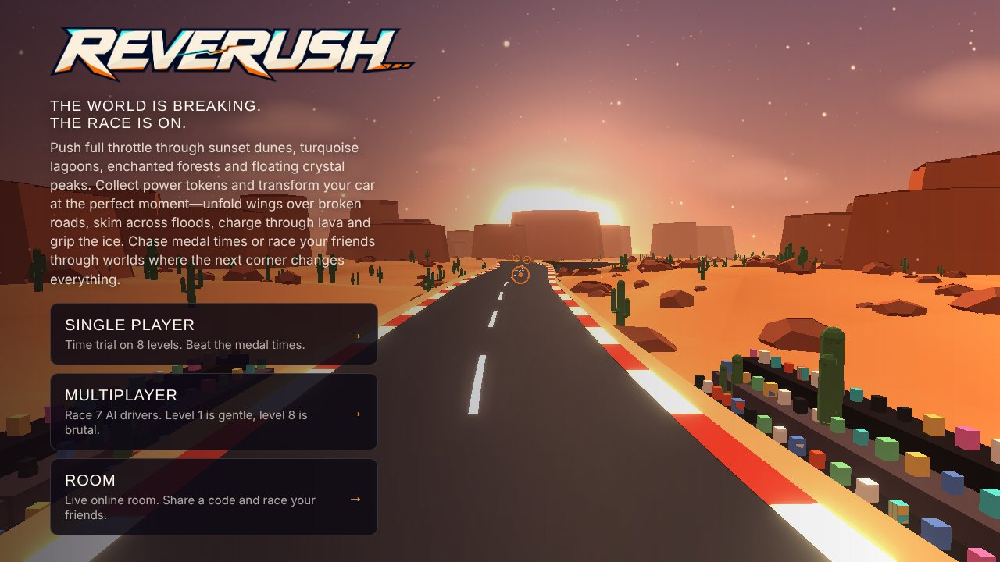
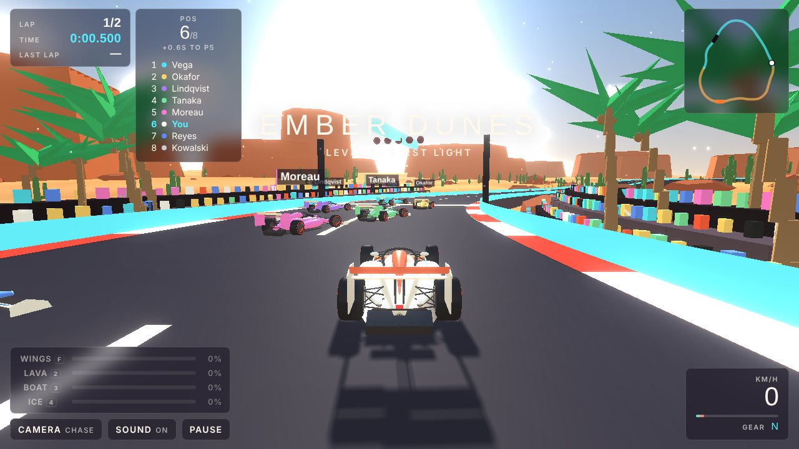
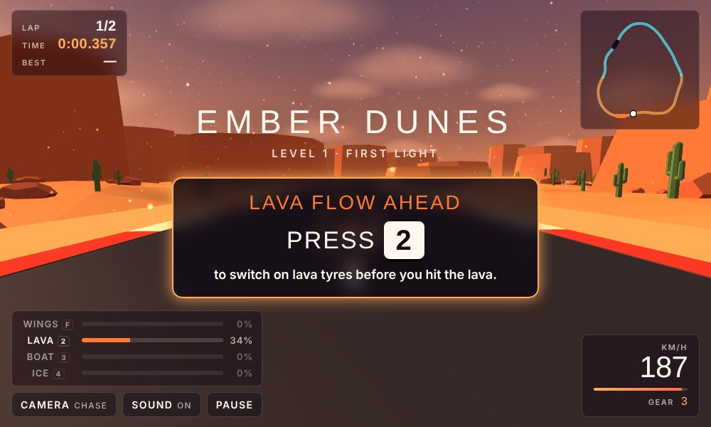
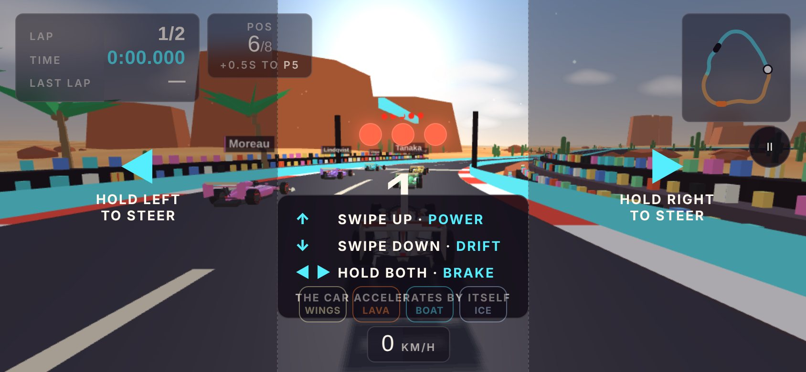
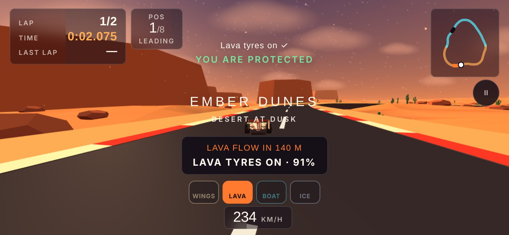

<p align="center">
  
</p>

<h3 align="center">The world is breaking. The race is on.</h3>

<p align="center">
Push full throttle through sunset dunes, turquoise lagoons, enchanted forests and floating crystal peaks. Collect power tokens and transform your car at the perfect moment—unfold wings over broken roads, skim across floods, charge through lava and grip the ice. Chase medal times or race your friends through worlds where the next corner changes everything.
</p>

<p align="center">
  <a href="https://koushani22.github.io/reverush/"><b>▶ Play Reverush</b></a>
</p>



---

## About

Reverush is a 3D Formula 1–style racer that runs in the browser, on desktop and on phones. There is nothing to install and no build step. An earthquake has broken every circuit, and each hazard can only be beaten by switching on the right power at the right moment.

| Hazard | Power | Key | Without it |
|---|---|---|---|
| Rift (gap in the road) | **Wings**: the car sprouts wings and flies | `F` | You fall and restart the lap |
| Lava flow | **Lava tyres**: glowing tyres that resist heat | `2` | Your tyres melt and you restart the lap |
| Flood | **Boat**: floats deploy and the car skims the water | `3` | You sink and restart the lap |
| Ice sheet | **Ice studs**: grip on ice | `4` | You slide |

Powers are charged by driving through coloured token rings: gold for wings, orange for lava tyres, blue for the boat and ice-blue for the studs. A switched-on power drains slowly, and faster while it is working.

## Game modes

- **Single player:** a time trial across 8 levels, with gold, silver and bronze medal times and a ghost of your best lap. Beat bronze to unlock the next level.
- **Multiplayer:** race 7 AI drivers from a full grid with start lights. Level 1 rivals are slow and make mistakes; by level 8 they are near-flawless. Finish on the podium to unlock the next level.
- **Room:** live online races with friends using a 4-letter room code. *Room mode uses Claude's live-room service, so it only works on the claude.ai-hosted version. On GitHub Pages the Room screen shows a short note, and the other two modes work fully.*

## Worlds

A single lap can pass through several worlds, which blend into each other as you drive:

- **Ember Dunes:** a desert at dusk with mesas and cacti
- **Glass Lagoon:** a turquoise coast with waves, palms and sailboats
- **Lantern Wood:** an enchanted night forest with an aurora, glowing mushrooms and floating lanterns
- **Prism Peaks:** a crystal snowfield with floating islands

## Screenshots

| Racing 7 AI drivers | Tutorial prompts |
|---|---|
|  |  |

| Phone controls | Racing on a phone |
|---|---|
|  |  |

## Controls

**Keyboard**

| Action | Keys |
|---|---|
| Throttle / brake and reverse | `W` `S` or `↑` `↓` |
| Steer | `A` `D` or `←` `→` |
| Handbrake (drift) | `Space` |
| Wings on / off | `F` (or `Shift`, `1`) |
| Lava tyres · Boat · Ice studs | `2` · `3` · `4` |
| Camera · Reset to track · Pause | `C` · `R` · `P` or `Esc` |

**Touch (phones and tablets)**

Touch controls follow the *Need for Speed: No Limits* style: no buttons to hunt for, just the two halves of the screen.

| Action | Gesture |
|---|---|
| Accelerate | Automatic |
| Steer | Hold the left or right half of the screen |
| Switch on the power for the hazard ahead | Swipe up |
| Drift | Swipe down (keep holding to keep drifting) |
| Brake | Hold both halves at once |
| Switch a specific power on or off | Tap its chip above the speed readout |

The game always plays in landscape. If your phone is held upright, the game turns itself sideways so you can simply rotate the phone. On Android, when the game is opened from its own web address, it also tries to go full screen and lock landscape.

## Publish on GitHub Pages

1. Create a new public repository on GitHub, for example `reverush`.
2. Upload the contents of this folder to the root of the repository, so that `index.html` sits at the top level. Include the hidden `.nojekyll` file.
3. In the repository, open **Settings → Pages**.
4. Under **Build and deployment**, set **Source** to *Deploy from a branch*, choose the `main` branch and the `/ (root)` folder, then save.
5. After a minute or two the game is live at `https://koushani22.github.io/reverush/`. Replace the **Play** link at the top of this README with that address.

To run it on your own computer, serve the folder with any static web server (for example `python3 -m http.server` inside the folder) and open `http://localhost:8000`. Opening `index.html` directly from disk also works in most browsers.

## Project structure

```
reverush/
├── index.html            Page shell, menus and HUD markup
├── css/style.css         All styling: HUD, menus, touch controls
├── js/game.js            The game: worlds, tracks, cars, AI, powers, physics, rooms
├── assets/
│   ├── logo.webp         Reverush logo
│   ├── icon.png          Browser tab icon
│   └── screenshots/      Images used in this README and for link previews
└── .nojekyll             Tells GitHub Pages to serve the files as they are
```

## Tech and performance

- Built with [three.js](https://threejs.org/) r128 (loaded from a CDN) and plain JavaScript, with no framework or build tools.
- Tracks, terrain and scenery are generated from a seed per level, so the whole game is under 200 KB plus the three.js library (about 150 KB compressed).
- Phones automatically get a lighter mode: no bloom glow, lighter shadows, lower render resolution, about half the scenery and fewer particles.
- On any device, if the frame rate drops below about 40 fps, the game steps its graphics down further: first the glow, then shadows, then resolution.
- Rival cars are merged into a few meshes each, and every level and car is cleaned out of memory when you leave it.
- Progress (unlocked levels, best times, medals and ghosts) is saved in your browser's local storage.

## Credits

- Game design and art direction: Koushani Datta
- 3D engine: [three.js](https://github.com/mrdoob/three.js) (MIT licence)
- Fonts: [Michroma](https://fonts.google.com/specimen/Michroma) and [Barlow Condensed](https://fonts.google.com/specimen/Barlow+Condensed) via Google Fonts (SIL Open Font Licence)

No licence is included, so all rights are reserved by default. If you want others to reuse the code, add a `LICENSE` file (MIT is a common choice).
